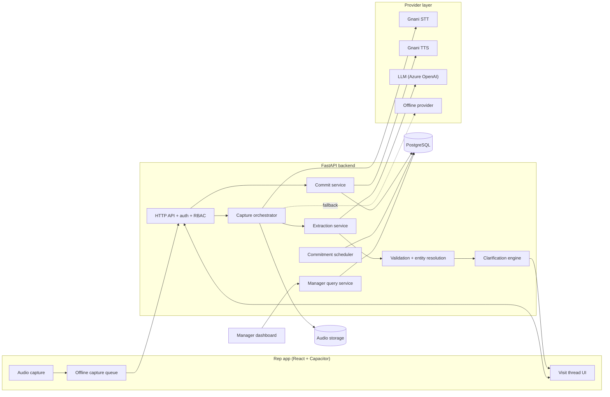
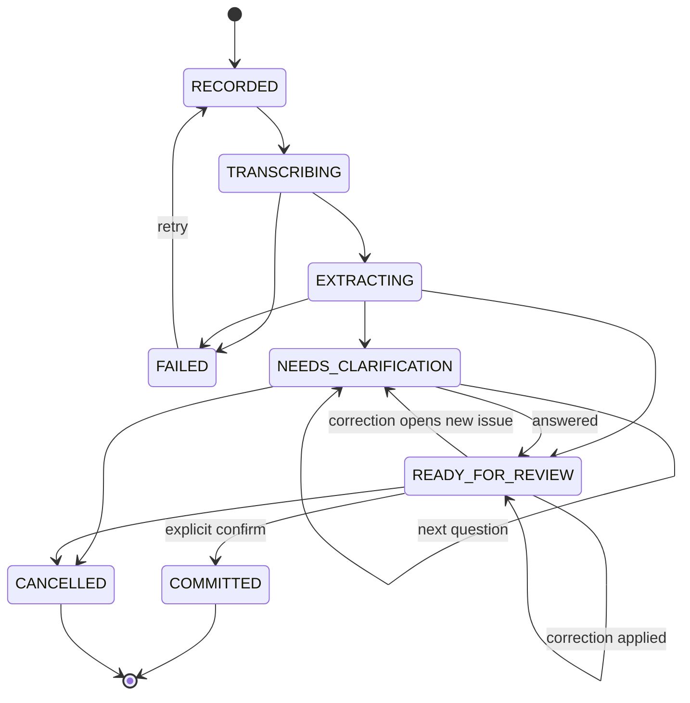

# Architecture

Summary document. Details: [docs/architecture/](docs/architecture/).

## Principles
1. AI proposes, application code commits.
2. Every external provider (STT, TTS, LLM) sits behind an interface with an offline deterministic fallback.
3. Network calls never run inside a database transaction.
4. All writes are idempotent; drafts are immutable revisions.
5. TTS is decoupled from commit; its failure never rolls back business data.
6. Analytics are database queries, never LLM-generated numbers.

## Components

## Component responsibilities

| Component | Responsibility |
|---|---|
| Audio capture | Record, show real level, preview, store locally until uploaded |
| Capture orchestrator | Lifecycle state machine; calls STT, then extraction; stores transcript and revisions |
| Provider layer | `SpeechToText`, `TextToSpeech`, `Reasoner` interfaces; live and offline implementations; retries, error categories, no payload logging |
| Extraction service | Prompt + strict JSON schema → visit bundle draft |
| Validation | Schema check, then business rules: catalogue match, unit compatibility, quantity, date normalisation, customer match with confidence thresholds |
| Clarification engine | Chooses the single highest-priority open question; applies answers/corrections as whitelisted patches creating a new revision |
| Commit service | One transaction: visit, orders, collections, complaints, commitments, outbox, audit; then post-commit TTS |
| Commitment scheduler | Surfaces due/overdue items; MVP uses a DB-polled job, not a broker |
| Manager query service | Fixed set of parameterised query intents mapped from the manager's spoken question |
| Sync (P1) | Accepts queued captures with client-generated idempotency keys |

## Capture lifecycle

## Trust and security
JWT auth with roles `rep`, `manager`, `admin`; row scoping by organisation and, for reps, by assigned territory. Provider keys are server-side only. Logs carry request IDs, timings and error categories, never audio, transcripts or amounts. Audio retention is configurable.

## Known constraints
- Offline *recording* is supported; offline *transcription* is not claimed.
- Gnani provides no translation endpoint; the LLM handles translation of spoken replies if needed.
- Verified against docs.gnani.ai (2026-11-04):
  - **STT REST accepts at most 30 s per request.** A spoken visit summary can exceed that. The orchestrator therefore either splits audio at silence into ≤28 s segments and stitches transcripts, or uses the streaming endpoint (15-minute sessions, 16-bit PCM frames of exactly 1,024 bytes). P0 uses segmentation over REST (simpler); streaming is P2.
  - **Default concurrency is one active request at a time per key.** All Gnani calls go through a single in-process gate (queue with backoff) so a 429 is rare; the demo must not run parallel captures.
  - Audio format is inferred from the file extension; supported: WAV, MP3, OGG, FLAC, AAC, M4A. WebM (browser default) is not listed.
  - STT code-mixed: `model=prisma-v3.0` with `format=codemix`, or `language_code=hi-IN,en-IN` / `indic-auto`.
  - TTS: `timbre-v3.0` (13 voices, all 10 languages) and `timbre-v2.5`; `hi-en` Hinglish language option with voice Poorvi on v2.5. Voices are not interchangeable between models.
  - 402 means insufficient credit; retry only 429/500/503/504 with backoff.
  - Pricing and rate numbers are not published; they are on app.gnani.ai.
- The installed `gnani-vachana` SDK (0.8.1) lags the docs (no `codemix`, no `timbre-v3.0`, no `hi-en`). **Decision: use a thin in-house HTTP client (httpx), not the SDK.**

## Browser and Android parity
Both targets share one capture pipeline; only the recorder differs. Browser `MediaRecorder` yields WebM, which Gnani does not list, so the web recorder encodes 16 kHz mono WAV client-side (AudioWorklet) and the Android recorder uploads AAC/M4A. The server still accepts both and transcodes only as a fallback. Both run the same contract and end-to-end tests.
