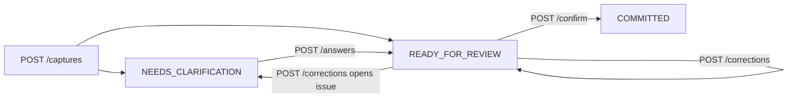

# API Reference (draft)

Status: planned contract; will be superseded by the generated OpenAPI document once the backend exists. Summary table: [API_DOCUMENTATION.md](../../API_DOCUMENTATION.md).

## Capture state flow



## Draft (visit bundle) shape

A visit has one order. Extracted lines carry `confidence` (0–1) and `evidence` (the phrase they came from) so the UI can show provenance. Open questions are not stored in the draft; the capture view derives `clarification` from the validator's first issue. Totals are recomputed by the server from catalogue prices.

```json
{
  "customer": { "spokenName": "Sharma ji", "customerId": "cus_…", "confidence": 0.93, "evidence": "Sharma ji ne" },
  "visit": { "purpose": "order and collection", "summary": "…" },
  "order": {
    "items": [
      { "spokenName": "Parle-G", "productId": "prd_…", "productName": "Parle-G Biscuit", "quantity": 20, "unit": "packet",
        "unitPricePaise": 1000, "matchStatus": "resolved", "confidence": 0.88, "evidence": "…" }
    ],
    "deliveryText": "kal", "deliveryDate": "2026-11-05"
  },
  "collections": [{ "kind": "promised", "amountPaise": 500000, "dueText": "kal", "dueDate": "2026-11-05", "evidence": "…" }],
  "complaints": [{ "category": "product_quality", "description": "…", "productId": null, "evidence": "…" }],
  "competitorNotes": [],
  "commitments": [{ "actionType": "visit", "description": "Visit again", "dueText": "agle Monday", "dueDate": "2026-11-09", "priority": "normal", "evidence": "…" }],
  "totalPaise": 20000
}
```

## Clarification rules
1. One open question at a time, highest business impact first (customer → product → quantity/unit → money → dates).
2. Options are drawn from the catalogue/customer list, not invented by the model.
3. Ambiguous dates ("next week", "after Diwali") ask for a concrete date rather than guessing.
4. Answers and corrections are applied only to whitelisted paths: `customer.customerId`, `orders.N.items.M.{productId,quantity,unit}`, `orders.N.deliveryDate`, `collections.N.{amountPaise,dueDate,kind}`, `complaints.N.*`, `commitments.N.{dueAt,description,priority}`.

## Corrections
Request: `{ "revision": 2, "text": "make juice 12 bottles" }` or audio. Response includes:
```json
{ "revision": 3, "patch": [{ "path": "orders.0.items.1.quantity", "old": 10, "new": 12 }], "unsupported": [] }
```
Unsupported requests are returned in `unsupported` and never silently dropped.

## Confirm
Requires current `revision`. Single transaction creates visit, orders, items, collections, complaints, commitments, outbox and audit rows. `reply.status` is `READY` or `FAILED` independently of success.

## Manager intents (initial allow-list)
`overdue_payments`, `inactive_retailers(days)`, `pending_commitments_by_rep`, `order_conversion_by_rep`, `declining_products`, `region_vs_target`. Each maps to one parameterised query; the response returns the named query ID for transparency.

## Gnani calls made by the backend (verified against docs.gnani.ai, 2026-11-04)
Host `https://api.vachana.ai`; auth header `X-API-Key-ID`; optional `X-API-Request-ID`.

| Purpose | Call |
|---|---|
| Transcribe | `POST /stt/v3` multipart: `audio_file`, `language_code` (e.g. `hi-IN,en-IN`, `indic-auto`), `model=prisma-v3.0`, `format` (`verbatim`, `transcribe`, `codemix`, `transliterate`), optional `keyterms`, `bias_list`, `topic`, `previous_text` |
| Speak | `POST /api/v1/tts/inference` JSON: `text`, `model` (`timbre-v3.0` or `timbre-v2.5`), `voice`, `language` (incl. `hi-en`), `speed` (0.85–1.15), `audio_config` |
| (P2) live transcript | WSS `/stt/v3/stream`, headers carry config, 16-bit PCM, 1,024-byte frames |

Limits: STT REST ≤ 30 s per request; one active request at a time by default. STT response includes `transcript`, `detected_language_code`, `request_id`, `processing_time`. Useful features for this product: `keyterms`/`bias_list` can be fed the customer and product names from the catalogue to improve recognition of brand names, and `previous_text` can carry the prior segment for long visits. Their effect on accuracy is untested and must be measured.

Errors: auth/rate/credit use `{detail:{error_code,message,status_code}}` (401 MISSING/INVALID_API_KEY, 402 insufficient credit, 403 SCOPE_NOT_ALLOWED, 429 RATE_LIMITED); STT body errors use `{success:false,error:{type,message}}`. Retry 429/500/503/504 with backoff; never retry other 4xx.
