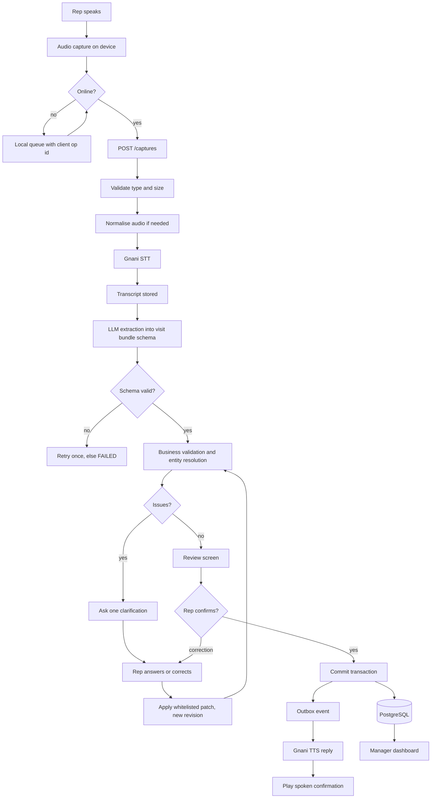
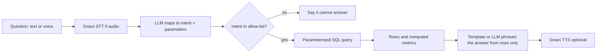

# Data Flow

## Visit capture to committed records

## Data classification

| Data | Where | Retention |
|---|---|---|
| Raw audio | Object/file storage | `AUDIO_RETENTION_HOURS`, then deleted |
| Transcript | `captures` | With the capture; excluded from logs |
| Drafts | `capture_drafts` | Immutable revisions kept for audit |
| Business records | visits, orders, collections, complaints, commitments | Permanent |
| Reply audio | storage + `reply_audio` | Same as raw audio |

## Manager question flow

The LLM never produces numbers; it only selects an intent and phrases results already computed by SQL.
