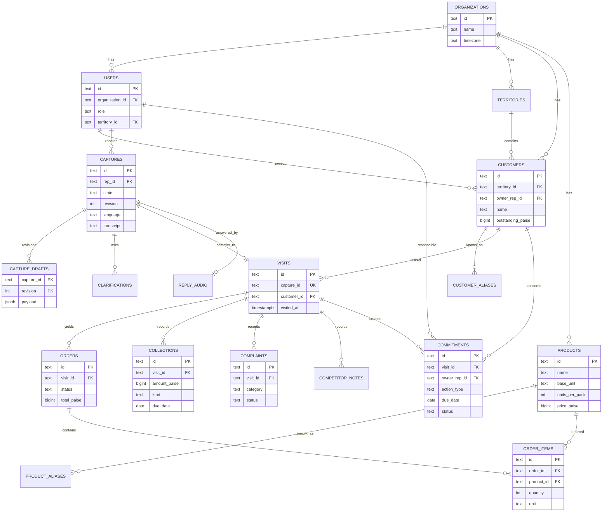

# Database ERD

Support tables not drawn for readability: `idempotency_keys`, `outbox_events`, `audit_log`, `reply_audio`, `customer_aliases`, `product_aliases`. The open clarification question is derived from the current draft revision's issues (no separate table). See [DATABASE_SCHEMA.md](../../DATABASE_SCHEMA.md).
