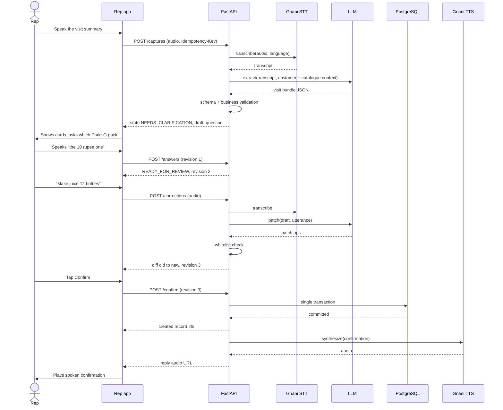
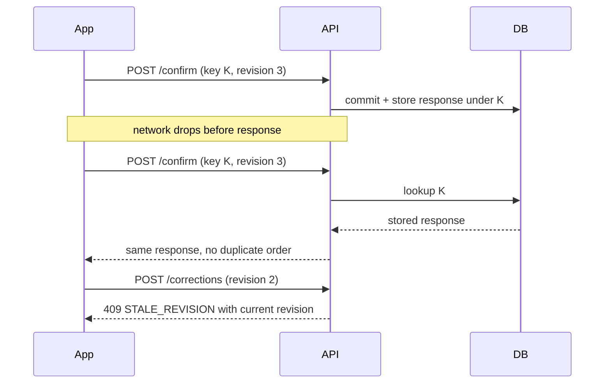
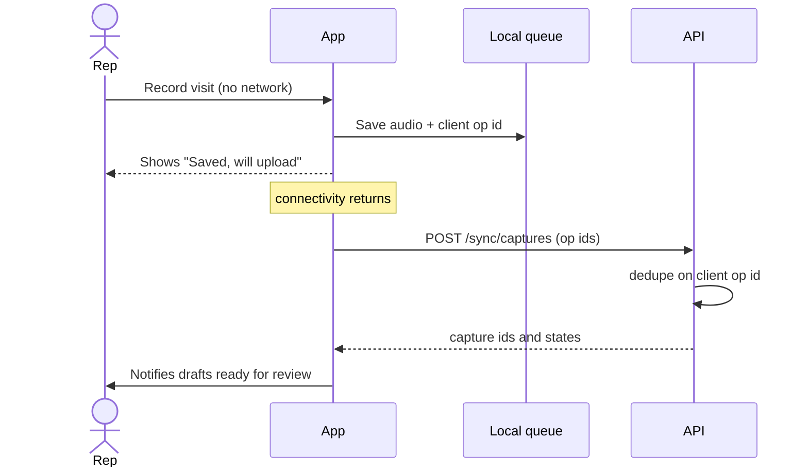
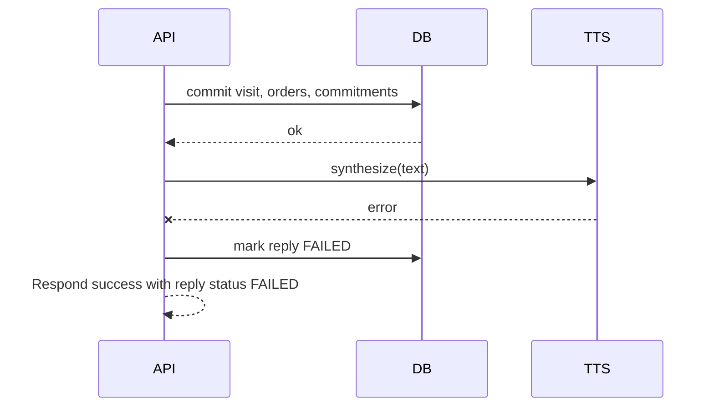

# Sequence Diagrams

## 1. Capture, clarification, correction, confirm (demo scenario)

## 2. Idempotent replay and stale revision

## 3. Offline capture and sync

## 4. Post-commit TTS failure

