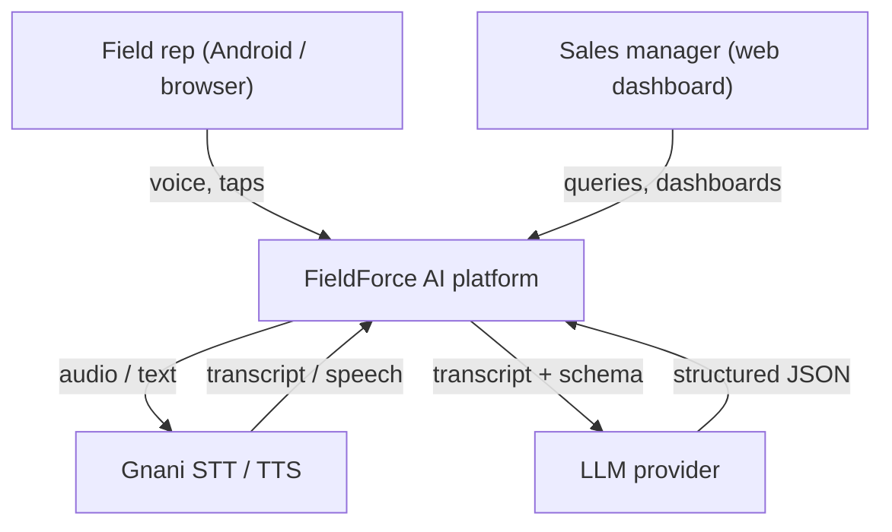
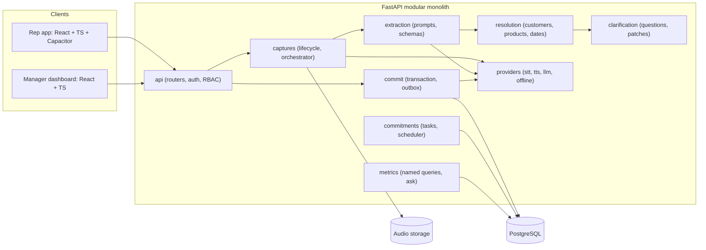

# System Architecture

## Context

## Containers

Why a modular monolith: one deployable unit is faster to build and demo; module boundaries (separate packages, no cross-imports except through service interfaces) keep a later split possible.

## Layering rules
1. `api` depends on services; services depend on `domain` and `providers` interfaces.
2. `domain` is pure (no I/O).
3. Only `commit` writes business tables, and only inside one transaction.
4. Providers are injected; the offline implementation must satisfy the same contract tests as live ones.

## Provider interfaces (conceptual)
- `SpeechToText.transcribe(audio, language) -> Transcript{text, language, requestId}`
- `TextToSpeech.synthesize(text, language) -> Audio{bytes, contentType}`
- `Reasoner.extract(transcript, context, schema) -> JSON`, `Reasoner.patch(draft, utterance) -> PatchOps`

## Failure domains
| Failure | Effect |
|---|---|
| STT down | Capture stays `RECORDED`/`FAILED`, retryable; audio kept |
| LLM invalid output | Rejected by schema; retry once, then `FAILED` with category |
| TTS down | Commit unaffected; reply marked failed; UI shows text |
| DB commit error | Whole transaction rolled back; client retries with same key |
| Network loss on device | Capture queued locally; synced later |
